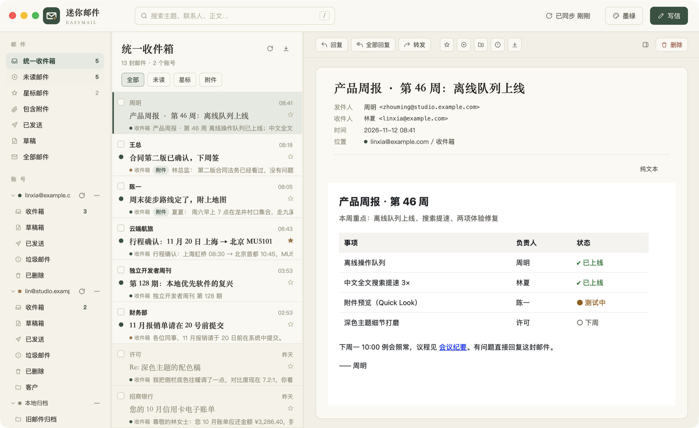
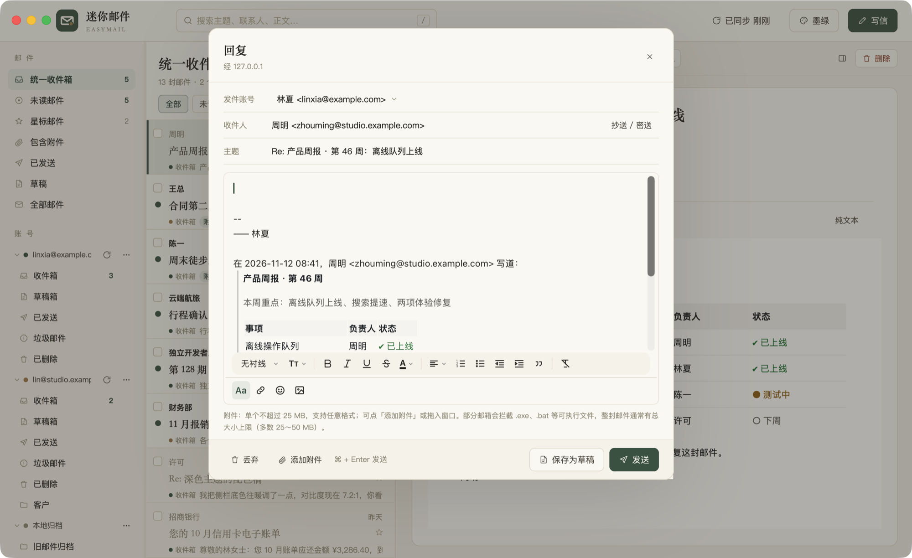
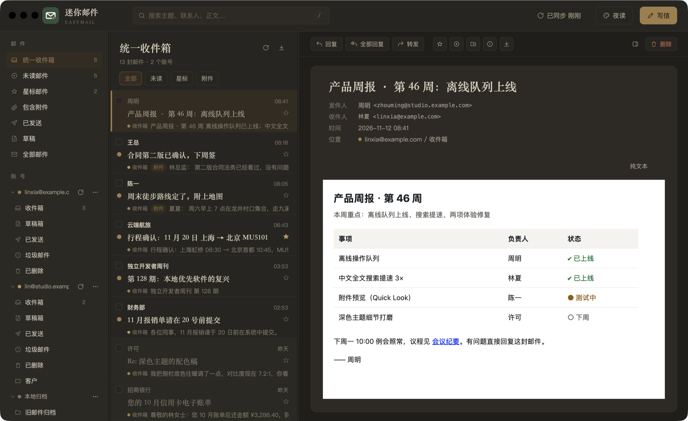
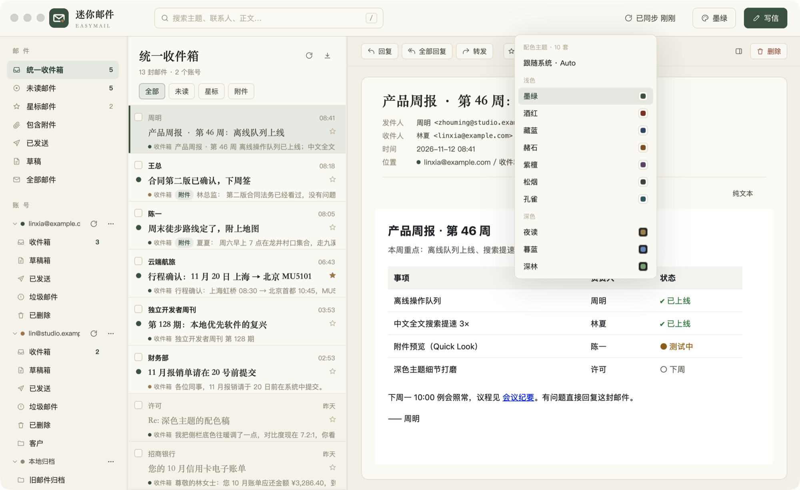
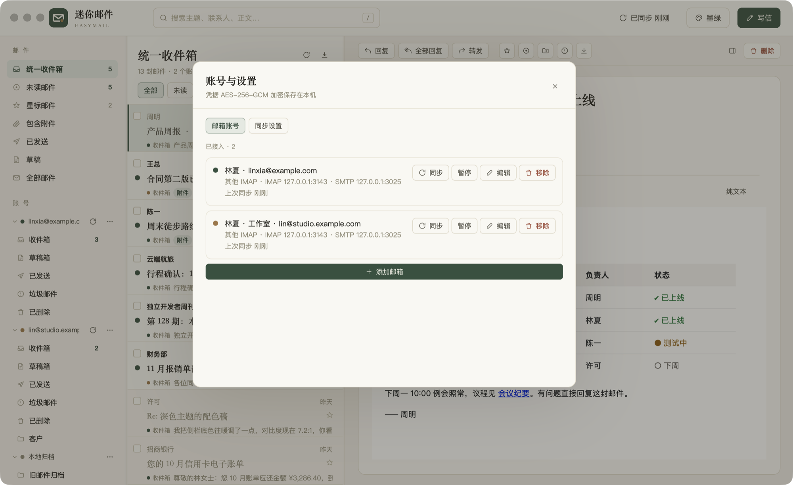

<p align="center"></p>

<h1 align="center">EasyMail · 迷你邮件</h1>

<p align="center">本地优先的多账号邮件客户端与归档工具 · Rust + <a href="https://www.gpui.rs/">GPUI</a> · macOS 原生</p>

<p align="center">
  <a href="https://github.com/davidzhanghui/easymail/releases/latest"></a>
  <a href="https://github.com/davidzhanghui/easymail/actions/workflows/ci.yml"></a>
  
  <a href="LICENSE"></a>
</p>

<p align="center">简体中文 · <a href="README_EN.md">English</a> · <a href="https://davidzhanghui.github.io/easymail/">官网</a></p>



## 功能

- **多账号**：Gmail、Outlook / Microsoft 365、iCloud、Yahoo、Fastmail、网易 163 / 126 / 企业邮、QQ / 腾讯企业邮、阿里邮箱、139、新浪、搜狐、AgentMail，以及任意 IMAP / SMTP 服务器；统一收件箱
- **OAuth 登录**：Outlook / Microsoft 365 用浏览器授权登录（XOAUTH2），不需要授权码；Gmail 也支持（需填自己的 Google Client ID）。自定义服务器可按邮箱域名自动查找配置（Thunderbird ISPDB）
- **本地优先**：邮件信封与正文缓存在本机 SQLite + `.eml` 文件里，离线可读可搜；离线时做的删除 / 移动 / 标记会排队，联网后自动送达
- **撤销与撤回**：移动 / 删除后几秒内可撤销（⌘Z）；发信先进发件箱，默认 5 秒内可撤回，也可以定时发送；网络失败自动退避重试
- **实时收信**：IMAP IDLE / NOTIFY；服务器不支持时可按文件夹勾选实时监听（否则 45 秒轮询），菜单栏托盘、Dock 角标、系统通知
- **全文搜索**：中英文子串搜索（FTS5 trigram + 中文二元组索引），支持 `from:` `to:` `subject:` `filename:` `in:` `is:unread` `is:starred` `has:attachment` `before:` `after:` `larger:` `smaller:` 与 `-排除词`；常用搜索可保存到侧栏
- **会话视图**：按 References / In-Reply-To 合并同一会话，列表一行一个会话
- **整理工具**：本地规则（新信自动移动 / 标记 / 归档）、稍后处理（到点回到收件箱）、发件人视图（按发件人批量已读 / 退订 / 删除）、一键退订（RFC 8058）、发票视图、回复模板、⌘K 命令面板
- **隐私与安全**：WKWebView 禁用脚本、无持久化存储，CSP 默认拦截远程图片（可按发件人放行）；显示被拦截的追踪像素与隐私报告；SPF / DKIM / DMARC 未通过、链接文字与实际地址不符时给出警告；打开链接时去掉 utm 等跟踪参数
- **阅读助手**：自动识别验证码（一键复制）、机票 / 火车票 / 酒店行程
- **富文本写信**：独立的写信窗口（主窗口可以继续翻邮件）、回复 / 全部回复 / 转发、签名、附件、内嵌图片；草稿自动保存并同步到服务器的「草稿」文件夹
- **十一套配色**：八套浅色 + 三套深色，可跟随系统
- **导入 / 导出 / 备份**：导入 `.eml` / `.mbox` 到「本地归档」；导出 mbox、CSV、标准 maildir；完整备份（附校验报告，可选密码加密）与应用内一键恢复、定时增量导出、账号间搬家（IMAP 复制，可断点续传）、安全瘦身
- **命令行与 AI 接入**：`easymail-cli` 可在终端搜索 / 阅读 / 导出本地邮件库，并提供只读的 MCP 服务器供本地 AI 工具使用
- **代理**：SOCKS5 / HTTP（含认证），可按账号开启；首次启动自动探测本机常见代理端口
- **连接诊断**：逐步检查代理 → DNS → 端口 → TLS → 登录，定位连不上的原因

| 写信 | 深色主题 |
| --- | --- |
|  |  |
| **配色主题** | **账号管理** |
|  |  |

## 安装

从 [Releases](https://github.com/davidzhanghui/easymail/releases/latest) 下载 `EasyMail-<版本>.dmg`（通用二进制，Apple Silicon 与 Intel 通用，macOS 12+），把「迷你邮件.app」拖入「应用程序」。

应用暂未经 Apple 公证，首次打开若提示「已损坏，无法打开」，在终端执行一次：

```bash
xattr -cr /Applications/迷你邮件.app
```

## 构建与运行

需要 macOS 与 Rust（版本由 `rust-toolchain.toml` 固定，`rustup` 会自动安装）。

```bash
cargo run                     # 开发运行
scripts/restart.sh            # 退出旧实例 → debug 增量构建 → 以 .app 形式启动（-n 不构建，-f 前台看日志）
scripts/check.sh              # 质量检查：fmt → clippy → 单元测试 → GreenMail 端到端 → 界面端到端
scripts/check.sh --no-ui      # 跳过需要图形会话的界面测试
scripts/build.sh              # 打包 dist/迷你邮件.app 与 DMG（arm64 + x86_64 通用二进制）
scripts/screenshots.sh        # 用演示数据重新生成 docs/screenshots/
scripts/bench.sh [封数]        # 大库性能基准（默认 10 万封合成邮件，临时目录，跑完即删）
scripts/push-tag.sh           # 按 Cargo.toml 版本打 tag 并推送，触发 GitHub Actions 发布 Release
```

端到端测试用本机的 [GreenMail](https://greenmail-mail-test.github.io/greenmail/)（Java，不用 docker）提供真实的 IMAP / SMTP。
jar 不在仓库里，`scripts/fetch-greenmail.sh` 会按固定版本与校验和下载到 `tools/`（`check.sh` 会自动调用）。
需要 Java 11 及以上。

解析器的 fuzz 目标在 `fuzz/`（`cargo +nightly fuzz run parse_message`，需要 `cargo install cargo-fuzz`）；稳定版上 `cargo test` 也会跑一轮随机变异测试。

### 性能参考

`scripts/bench.sh` 在 Apple Silicon（M 系列）上、10 万封邮件的结果（中位数）：

| 场景 | 耗时 |
| --- | --- |
| 收件箱首屏 60 封（含计数） | ~1 ms |
| 翻页 | ~2 ms |
| 全文搜索（中文两字 / 英文词 / 组合条件） | 22–28 ms |
| 会话视图首屏 | ~160 ms |
| 发件人汇总前 200 | ~95 ms |

## 命令行与 MCP

打包后的 `迷你邮件.app/Contents/MacOS/easymail-cli` 直接读本地邮件库（只读，不需要打开 App）：

```bash
easymail-cli search "from:bob 发票 after:2025-01" --limit 20
easymail-cli show 1234
easymail-cli export mbox ~/out.mbox "is:starred"
easymail-cli backup ~/Backups
easymail-cli mcp          # 以 stdio 方式运行 MCP 服务器
```

在支持 MCP 的 AI 工具里这样配置（工具：`search_mail` / `read_mail` / `list_folders` / `mail_stats`，全部只读，不能发信或删信）：

```json
{
  "mcpServers": {
    "easymail": {
      "command": "/Applications/迷你邮件.app/Contents/MacOS/easymail-cli",
      "args": ["mcp"]
    }
  }
}
```

每次工具调用都会记录到数据目录的 `mcp-audit.log`。注意：接入 MCP 意味着你允许该 AI 工具读取你的邮件内容。

## 数据目录

默认 `~/Library/Application Support/EasyMail/data`，可用环境变量 `EASYMAIL_DATA_DIR` 覆盖。

| 文件 | 内容 |
| --- | --- |
| `easymail.db` | SQLite 数据库（WAL） |
| `eml/<账号>/<邮件>.eml` | 邮件原文缓存 |
| `uploads/` | 写信时添加的附件（发出后清理） |
| `master.key` | 加密邮箱密码用的主密钥（0600）。**备份数据目录时它和数据库在一起，请妥善保管** |
| `easymail.log` | 运行日志（5 MB 轮转，`EASYMAIL_LOG=debug` 调高级别） |
| `panic.log` | 崩溃信息（下次启动时会提示） |
| `mcp-audit.log` | MCP / 命令行工具的调用记录 |

## 安全与隐私

- 没有任何遥测与统计。App 只会访问以下网络地址：
  - 你配置的邮件服务器（及代理）；
  - 你点「显示图片」或把发件人加入白名单后放行的远程图片；
  - 检查更新：每天最多一次请求 GitHub Releases 的公开接口，不带任何设备标识；可在「账号与设置 → 设置」里关闭；
  - 仅在你点「立即更新」时：从 GitHub Releases 下载新版 dmg。更新包先用内置公钥校验 Ed25519 签名和 SHA-256，通过才会安装，之后自动重启；不签名的发布只提示、不自动安装；
  - 仅在你主动操作时：OAuth 登录（Microsoft / Google 授权服务器）、按邮箱自动查找服务器配置（域名自身的 autoconfig 与 Thunderbird 公共配置库）、一键退订（请求发件人提供的退订地址）。
- 邮箱密码 / OAuth 令牌用 AES-256-GCM 加密后存在本机数据库，密钥在 `master.key`（0600）。「完整备份」会把 `master.key` 一起备份，不设密码的备份目录请像密码一样保管；设置密码后备份是单个 `.embak` 加密文件，`master.key` 也在密文里（密码无法找回）。
- 邮件正文（`.eml` 与数据库）在本机不额外加密，依赖系统的 FileVault 全盘加密，建议开启。
- 发现安全问题请看 [SECURITY.md](SECURITY.md)，不要直接公开提 issue。

### Outlook / Microsoft 365 的 OAuth

内置的 Client ID 在 Azure 中注册为「移动和桌面应用程序」，重定向 URI 为 `http://localhost`，支持任意组织账号与个人 Microsoft 账号。若你的组织要求使用自己的应用注册，在「账号与设置 → 设置」里填入你的 Client ID 即可（同样需要 `IMAP.AccessAsUser.All`、`SMTP.Send`、`offline_access` 权限）。Gmail 的 OAuth 需要你在 Google Cloud 创建「桌面应用」凭据并填入 Client ID / Secret；不填则继续用应用专用密码。

### 已知限制

- 界面目前只有简体中文。
- 基于 GPUI 的自绘界面对 VoiceOver 等辅助功能的支持有限（GPUI 尚未提供完整的无障碍树）。
- 应用暂未公证；主密钥存放在数据目录而不是钥匙串。

## 参与贡献

欢迎 issue 与 PR，请先阅读 [CONTRIBUTING.md](CONTRIBUTING.md) 与 [行为准则](CODE_OF_CONDUCT.md)。更新记录见 [CHANGELOG.md](CHANGELOG.md)。

## 文档

- [邮件服务商的怪癖](PROVIDER_QUIRKS.md)
- [vendor/gpui 补丁清单](vendor/PATCHES.md)
- [第三方许可声明](THIRD_PARTY_NOTICES.md)

## 许可

[MIT](LICENSE)。`vendor/gpui` 为 Apache-2.0，见 [THIRD_PARTY_NOTICES.md](THIRD_PARTY_NOTICES.md)。
