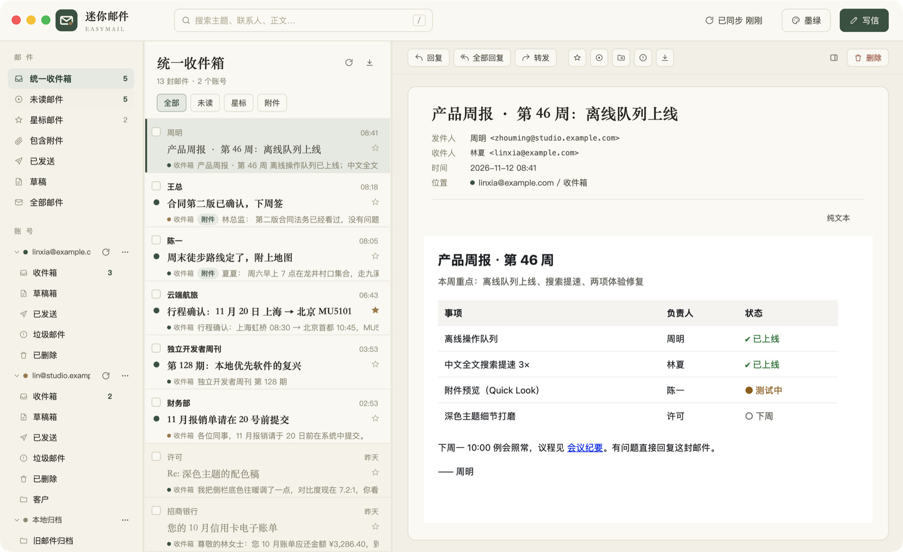
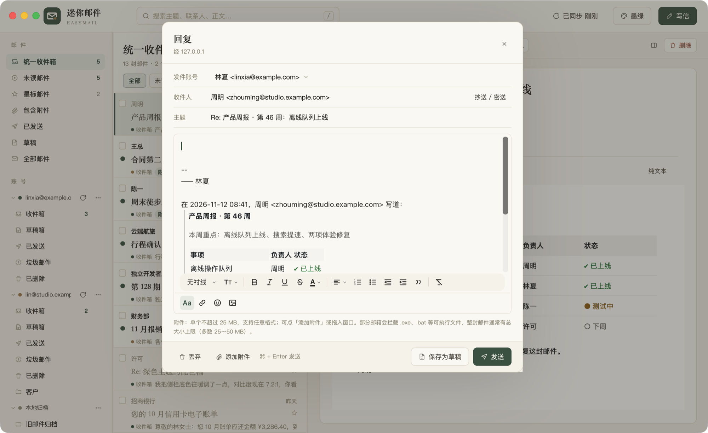
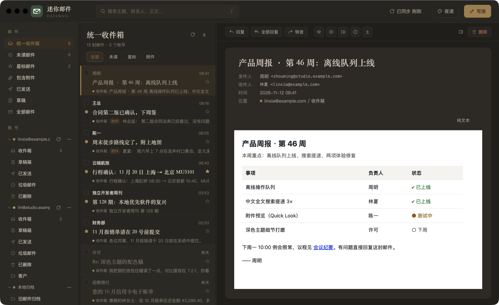
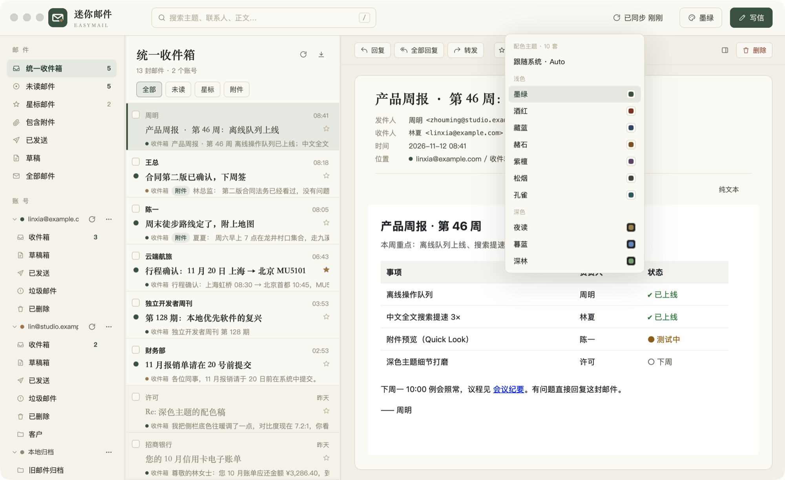
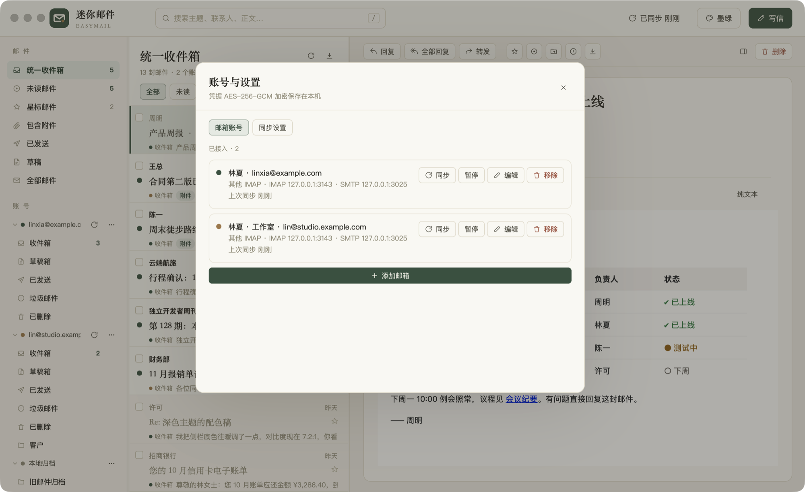

<p align="center"></p>

<h1 align="center">EasyMail</h1>

<p align="center">A local-first, multi-account email client and archiver · Rust + <a href="https://www.gpui.rs/">GPUI</a> · native macOS</p>

<p align="center">
  <a href="https://github.com/davidzhanghui/easymail/releases/latest"></a>
  <a href="https://github.com/davidzhanghui/easymail/actions/workflows/ci.yml"></a>
  
  <a href="LICENSE"></a>
</p>

<p align="center"><a href="README.md">简体中文</a> · English · <a href="https://davidzhanghui.github.io/easymail/">Website</a></p>



> The UI is currently in Simplified Chinese (the app is named 迷你邮件, "Mini Mail"). English localization is welcome as a contribution.

## Features

- **Multiple accounts** — Gmail, NetEase 163 / 126, QQ Mail, AgentMail and any IMAP / SMTP server (password or app password), with a unified inbox
- **Local-first** — envelopes and bodies are cached in SQLite + `.eml` files, readable and searchable offline. Deletes / moves / flags made offline are queued and delivered when you're back online
- **Real-time** — IMAP IDLE (45 s polling fallback), menu-bar tray, Dock badge, system notifications
- **Full-text search** — substring search for CJK and Latin text (FTS5 trigram + CJK bigram index) with `from:` `to:` `subject:` `is:unread` `is:starred` `has:attachment`
- **Safe rendering** — WKWebView with JavaScript disabled; a CSP blocks remote images (tracking pixels) until you click "Show images"
- **Rich-text composer** — reply / reply all / forward, signatures, attachments, inline images, drafts
- **Ten color themes** — seven light, three dark, or follow the system
- **Import / export** — import `.eml` / `.mbox` into a local archive; export mbox, CSV or a standard maildir
- **Proxies** — SOCKS5 / HTTP (with auth), per account

| Composer | Dark theme |
| --- | --- |
|  |  |
| **Themes** | **Accounts** |
|  |  |

## Install

Download `EasyMail-<version>.dmg` from [Releases](https://github.com/davidzhanghui/easymail/releases/latest) (universal binary for Apple Silicon and Intel, macOS 12+) and drag `迷你邮件.app` into Applications.

The app is not notarized yet. If macOS says it is "damaged", run once in Terminal:

```bash
xattr -cr /Applications/迷你邮件.app
```

## Build & run

Requires macOS and Rust (pinned by `rust-toolchain.toml`; `rustup` installs it automatically).

```bash
cargo run                     # run in development
scripts/restart.sh            # quit running instance → incremental debug build → launch as .app (-n: no build, -f: foreground logs)
scripts/check.sh              # fmt → clippy → unit tests → GreenMail end-to-end → UI end-to-end
scripts/check.sh --no-ui      # skip UI tests that need a graphical session
scripts/build.sh              # package dist/迷你邮件.app and a DMG (arm64 + x86_64 universal binary)
scripts/screenshots.sh        # regenerate docs/screenshots/ from demo data
scripts/push-tag.sh           # tag the Cargo.toml version and push it, triggering the Release workflow
```

End-to-end tests run against a local [GreenMail](https://greenmail-mail-test.github.io/greenmail/) (Java, no Docker) for real IMAP / SMTP.
The jar is not committed; `scripts/fetch-greenmail.sh` downloads a pinned version with checksum into `tools/` (`check.sh` calls it). Requires Java 11+.

## Data directory

Defaults to `~/Library/Application Support/EasyMail/data`; override with `EASYMAIL_DATA_DIR`.

| File | Contents |
| --- | --- |
| `just-mail.db` | SQLite database (WAL). Name kept from the predecessor just-mail for compatibility |
| `eml/<account>/<message>.eml` | Raw message cache |
| `uploads/` | Attachments added while composing (cleaned after sending) |
| `master.key` | Master key for encrypting mailbox passwords (0600). **Keep it safe when backing up the data directory** |
| `easymail.log` | Log (rotated at 5 MB; `EASYMAIL_LOG=debug` for more detail) |
| `panic.log` | Crash information |

## Security & privacy

- No telemetry. Apart from your mail servers (and proxy) and remote images you explicitly allow, the app contacts nothing else.
- Mailbox passwords are encrypted with AES-256-GCM in the local database; the key lives in `master.key` (0600).
- Please report vulnerabilities privately as described in [SECURITY.md](SECURITY.md).

## Contributing

Issues and PRs are welcome — see [CONTRIBUTING.md](CONTRIBUTING.md) and the [Code of Conduct](CODE_OF_CONDUCT.md). Release notes: [CHANGELOG.md](CHANGELOG.md).

## License

[MIT](LICENSE). `vendor/gpui` is Apache-2.0, see [THIRD_PARTY_NOTICES.md](THIRD_PARTY_NOTICES.md).
